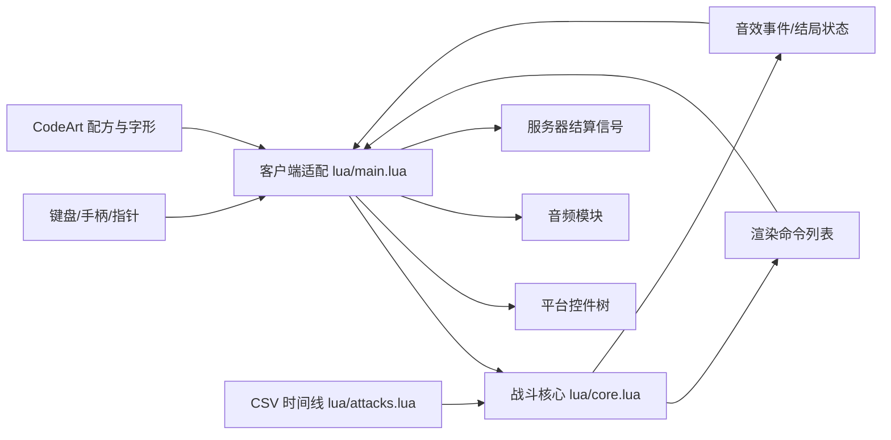

# Bad Time 战斗：项目交接与开发说明

交接快照日期：2026-10-08。目标平台：千星奇域官方客户端控件与 Lua 5.3。当前构建标记：`2026-10-08-review-3-text-pause-stab`。

本文给朋友和继续改造本项目的 AI 阅读。包含项目目标、架构、设计依据、重要接口、现有实现、复现步骤、测试边界与后续任务。设计部分解释实现选择和取舍，不把未验证的能力当作已经完成。

## 1. 先了解这份项目是什么

这是在千星客户端 UI 内运行的 2D 战斗。它用 Lua 管理独立的战斗生命值、心形玩家、攻击时间线、菜单、音效和结算发送；用客户端控件绘制 Sans、骨头、龙骨炮、文字和界面。画面由几何图元组成，不要求导入原作角色贴图。

目标是逐步还原 Undertale 的 Sans / Bad Time 战斗。实现以公开的 Bad Time Simulator 为主要行为参考，而不是直接运行原作游戏代码。当前已实现主体流程，但没有做到逐项完整的一比一还原。

用户最初提供的是大型合并 `main.lua`。本轮工作先备份原文件，拆出可维护模块，对照官方 API 和参考攻击修正流程、物理、绘制及输入。用户另行要求 CodeArt 子代理，子代理负责角色与画面配方；主适配层接入这些配方。之后根据用户官方试玩截图修复了中文文字消失、开场骨刺画成巨大单骨，并增加右上角暂停按钮。

**本包包含：**完整工作目录源码、已生成的导入脚本、参考快照、测试、工具、文档、离线预览及文件校验清单。

**本包不包含：**可直接打开的官方游戏工程存档、已创建的客户端模板资产、原作音频、服务器结算节点图存档、父目录知识库、Python 安装环境。新工程要按部署文档配置这些平台资源。

用户已提供游戏内截图，说明其工程至少运行到了画面与攻击阶段；截图不能证明所有输入、结算和完整战斗通过。本轮修改后的界面只有离线验证，仍需再次官方试玩。

## 2. 给接手者的阅读顺序

1. 本文：理解当前结构、约束和剩余差异。
2. [部署与设置](部署与设置.md)：两个窗口内的具体操作、模板、输入、声音和服务器结算。
3. [审查与验证](审查与验证.md)：已修复问题、验证依据与局限。
4. [CodeArt 说明](CodeArt说明.md)：角色配方、LOD、图集和预览。
5. 根目录 `AGENTS.md`：后续 AI 的修改规则。
6. 看 `lua/config.lua`，再看 `lua/core.lua` 与 `lua/main.lua`。需要复核攻击时才深入 `reference/Battle.xml`。

根目录 `PACKAGE_MANIFEST.json` 列出包内每个项目文件的大小和 SHA-256，清单本身不记录自身哈希。ZIP 外面的 `.sha256.txt` 是整个压缩包的校验值。

## 3. 文件地图

```text
项目根目录/
  main.lua                       正式导入文件，由工具生成
  README.md                      快速入口
  AGENTS.md                      后续 AI 工作约定
  requirements-dev.txt           离线验证依赖版本
  PACKAGE_MANIFEST.json           打包时生成的文件校验清单
  lua/
    config.lua                   工程与规则配置
    core.lua                     纯 Lua 战斗核心
    attacks.lua                  24 份参考 CSV 的模块形式
    fitdata.lua                  角色与元素的 CodeArt 几何配方
    textart.lua                  已生成的中文/ASCII 矩形字形
    music.lua                    2D BGM、短音效及可选单音近似
    main.lua                     平台适配、绘制、输入、生命周期
  tests/
    test_core.lua                核心机制与完整时间线
    test_adapter.lua             官方 API 替身与输入/暂停/结算
    test_render_flow.lua         全流程经过实际绘制层
  tools/                         构建、验证、预览、生成与历史迁移工具
  reference/
    main.original.lua            用户最初代码备份
    Battle.xml                   参考项目战斗事件表快照
    upstream/                    Items.xml 与原始 24 份攻击 CSV
  docs/                          部署、审查、CodeArt、本交接文档与预览
```

`reference/` 默认只读，不拿它作为当前生产代码编辑。不要混淆根目录 `main.lua` 和 `lua/main.lua`：前者是生成结果，后者才是适配层源码。

## 4. 架构与编写思路

### 4.1 分开战斗规则和平台操作



核心不直接依赖平台控件或音频实例，因此可以在 Lua 5.3 中离线验证时间线、跳跃和 KR。适配层负责官方 API 的类型、坐标、实例化和生命周期。这样修改 UI 不必改战斗规则，修改规则也能先跑核心检查再看画面。

### 4.2 为什么保留 CSV 时间线

参考攻击包含延时、标签、跳转、变量、并行弹幕以及框尺寸变化，不能用“每回合固定几秒、随机生成一些骨头”代替。现在保留 24 份原 CSV，以解析器与 World 时间线执行。模块生成只处理名称别名，不改原 CSV 数值。

带脚本的攻击以 `EndAttack` 为结束依据，不让静态时长估算截断循环。普通行动和 FIGHT 分别影响不同的进度：玩家吃道具不能直接把 FIGHT 门控推进到终盘。

### 4.3 为什么采用固定逻辑步长

每个宿主帧接收输入一次，再通过累积器执行 60 Hz 的逻辑步。显示只读本帧结果。这样不同显示帧率下的移动、KR 和时间线较一致。输入帧的 dt 最大计入 0.25 秒，严重卡顿不会无限追赶；因此长卡顿时逻辑战斗时间会比现实时间慢，这是当前选择的取舍。

默认只用 `OnLevelUpdate` 推进。`OnUpdate` 只在配置 `updateCallback='ui'` 的外部宿主中转发，不能两者都推进。

### 4.4 为什么不继续用整张图片或原生文字

角色采用可维护的几何像素配方，符合用户要求的 CodeArt。首次使用时创建配方控件，之后复用；密集炮采用粗粒度 LOD，避免每帧重建整套角色。

早期中文通过原生文本模板显示，用户截图中中文消失而像素 HUD 正常。无法仅凭截图确定字体模板内部的具体原因，因此现在把按钮、对白与提示改成项目内置矩形字形，移除运行时字体依赖。这个选择增加控件数量；还原度与性能之间需要在真机继续评估。

### 4.5 为什么保留单文件导入

官方工程中的脚本映射和部署入口尽量只保留一个文件。开发时拆模块，构建时按固定顺序把它们包进根 `main.lua`。文件顶部定义内部 `__modules` 和 `require`，不需要在游戏里部署真实的 `default_import_file/workspace/sans-fight/lua/` 目录。这个字符串是内部键；移动项目文件夹不影响它。

## 5. 核心状态、时序和扩展接口

主要状态为 `title`、`enemy`、`menu`、`sub`、`attack`、`result`。中场和终盘通过附加标记控制，不要仅凭状态名称判断阶段。

| 对象/接口 | 用途 | 修改时要注意 |
| --- | --- | --- |
| `core.newTitle(opts)` | 建立标题状态 | 官方启动采用标题入口 |
| `core.newGame(opts)` | 建立战斗实例 | 测试常直接使用，不能混同正式开局行为 |
| `core.titleChoose(g, i)` | 选择难度并开局 | 会重置战斗并改变 runSeq |
| `core.update(g, input, dt)` | 输入消费、固定步推进、返回渲染命令 | 不要在适配层另调 Game:update 再调此接口 |
| `core.render(g)` | 得到显示命令 | 暂停可只渲染，不推进逻辑 |
| `core.newWorld(...)` | 创建脚本时间线世界 | 检查解析、执行与弹幕生命周期 |
| `Game:startEnemyScript` | 进入指定攻击脚本 | 不要同时叠加旧随机生成器 |
| `Game:afterPlayerTurn` | 玩家行动结束 | 会涉及独立脚本游标 |
| `Game:hurt` / `updateKR` | 直接伤害和延后扣血 | KR 不能单独致死 |
| `Game:finish` / `settle` | 进入结局与申请发送 | 保持原 outcome |
| `core.snapshot/debug/hud` | 调试与检查 | 不是已完成的断线存档协议 |

`World.paused` 是 CSV 时间线的局部暂停，`M.runtime.paused` 是用户按钮暂停。两者不是同一开关，不能为了加暂停而直接覆盖前者。

`fightCount` 是 FIGHT 门控，不是敌方脚本总执行次数。第一、第二阶段各有脚本游标，阶段内游标耗尽后可能随机选择攻击。HUD 中的计数也不能当作“第几份 CSV”。

每个逻辑步内必须按现有状态处理结束优先级：如果伤害已经致死，即使同一步脚本执行了 EndAttack，也不能再把结果改回菜单。

## 6. 当前战斗规则与还原范围

默认 `original`，HP 上限 92。默认库存为派 1、面 1、牛排 1、英雄补给 5，共 8 次；参考恢复量分别为 99、90、60、40，最终受 HP 上限限制。练习难度和额外面包是扩展配置，不算原作规则。

基准 FIGHT 流程为开场见面杀、第一阶段、13 次 FIGHT 附近的中场、第二阶段、23 次 FIGHT 门控对应终盘。中场的检查/补给不会自动开始第二阶段，确认饶恕才触发原作档陷阱；FIGHT 继续战斗。

红心没有重力，可四向自由移动，松开方向后保持位置。蓝心受四向重力，反重力方向或确认键可跳跃；轻点与长按影响跳高。不要因红心不下落而给整个游戏加统一重力。

KR 上限 40，并不超过 HP−1；KR 自燃不能独自把 HP 减到 0。首次/重复接触同一弹幕的 Karma 处理与直接伤害分开，补给不自动清除现有 KR。普通伤害与 KR、甩击等路径不能混成一个统一计数。

龙骨炮的 `BlastTime=0` 表示额外停留时间为 0，仍有生长、开火衰减与退休过程，不表示永久激光。当前炮只更新一次，核心碰撞与绘制共用光束状态。

开场 BoneStab 是沿边缘伸出的整片墙。以前把它的宽高直接当成一根骨头，导致巨大圆头横骨；现在按方向绘制一排 8 px 宽细骨并裁切在框内。**细骨之间的小缝隙是装饰，不是可穿过的安全区**，碰撞仍采用整片墙。

## 7. 坐标、碰撞和绘制约定

逻辑视口是 640×480，原点左上，Y 向下。平台画布原点左下，Y 向上。适配层按 `S=min(canvasWidth/640, canvasHeight/480)` 等比缩放，用 OX/OY 居中。

世界点的显示位置大致为 `canvasX=OX+x*S`、`canvasY=OY+(480-y)*S`。矩形绘制时要用其底边转换，旋转对象还涉及中心锚点。指针通过逆变换还原世界坐标。不要在每个弹幕函数中再添加一套 Y 翻转。

脚本坐标到战斗显示坐标的转换由核心完成，渲染命令进入适配层后按约定直接显示。源码保留一些历史坐标说明和兼容代码，不能看到旧注释就再次加平移。战斗框插值也只在核心执行；显示层再平滑会造成可见边界落后于碰撞。

图层为背景、烘焙角色、world、soul、uiBackdrop、ui、pause 等层。黑底必须低于文字，灵魂必须高于世界弹幕，暂停层最后置顶。控件池按种类和图层分开，避免后来创建的激光压住旧控件。

渲染命令包含 `box/bone/blaster/stab/sine/platform/soul/menu/sub/hudText/hudBar/attackBar/flash` 等。增加一种攻击时应先确定核心状态、渲染命令和碰撞形状，再接入适配层，最后检查两者一致。

平台单位不是灵魂命中尺寸；心形外观约 16 px，核心以较小 hitbox 处理部分碰撞。不要把视觉外轮廓直接替代所有判定参数。

## 8. CodeArt、中文字形与性能

`fitdata.lua` 中素材采用 `{w,h,rects={{x,y,w,h,c},...}}`，颜色是整数 ARGB，适配层转换为官方 ColorValue。包含 Sans 头/身体、左右镜像、疲惫状态、四向灵魂、龙骨炮开合、菜单、平台、死亡裂心及像素英文等。

Sans 的头和身体分别取键，保证表情变化不会把身体整体拉伸。龙骨炮有完整配方、block2、block3 等 LOD。配方数据和绘制角度都要遵守当前约定；尤其翻转后不要再重复倒置 Y。

`textart.lua` 的中文字形是已生成的数据表；运行时遍历 UTF-8 codepoint，把字形矩形转换为缓存的控件容器。缓存区分字形、颜色、图层，并为一帧内的重复字创建多个实例。ASCII HUD 仍可使用 fitdata 内的 5×7 像素字。中文、大小写英文、符号的排版风格并不完全相同。

生成工具 `generate_textart.py` 扫描 Lua 文件中的非 ASCII 字符，同时收集可打印 ASCII。在本机使用微软雅黑和 Consolas 栅格化，再合并连续矩形。它也会收集注释中的字符，因此字形表不是最小字库。字体文件未打进包，已有字形表足够让游戏运行和普通构建。

添加新显示文案时，要确保所有新字在表内；未知字符会回退为问号。当前排版主要做宽度缩放，不是完整自动换行/富文本布局。特别长的对白和动态文本需要先设计换行和缓存上限，避免字号缩得不可读或缓存持续增长。

离线全阶段采样创建了 9730 个模拟控件；替身模板采用外层容器加叶子，数量不能直接等同于真机耗时或帧率。当前没有官方控件上限和设备负载实测结果。优化优先检查活跃控件数、缓存复用、字形数量、LOD 及重复短音，而不是先减慢核心物理。

## 9. 平台 API 与输入的关键事实

以下来自已读取的官方客户端资料镜像，接手时如平台更新应重新核验。

- `script.object` 是脚本宿主；脚本挂在根容器节点。控件默认可能未激活，父层和叶子都要激活及可见。
- 控件身份字段是小写 `id`，模板索引不是运行时 id。配置应填保存模板的根节点索引。
- 模板可以直接是叶子，或是容器包装叶子；当前按可用接口寻找实际控件，再归一化包装层。
- `imageColor/fontColor/bgColor` 要官方 ColorValue，不能把整数原样当 API 类型。
- `SetLocalRotation` 是三个参数，2D 旋转在 Z 轴；只传一个角度会写错轴。
- 键事件与对齐使用 EnumItem。`fontSize` 为整数；保留的原生文本回退要继续遵守类型。
- 指针监听用光标检测区域，`root.showCursor=true`；不要把未文档化的 raycastTarget 写到所有图片上。
- 添加/移除按键监听时必须保留同一个回调对象。销毁清理自建控件，不销毁宿主 root。

键盘采用 WASD/方向键移动，Z/J/空格确认，X/退格返回或慢走。输入记录每个实际按键的 held 状态，避免 W 与上箭头同时按住时松开其中一个取消整个方向。

触摸左半屏在敌方阶段可拖动摇杆；菜单选择采用点选再点确认。touchId 绑定摇杆所有者，第二触点不能抢走或结束当前拖动。光标按下/松开/点击会去重，不要让一次鼠标点击又走普通攻击键确认。

手柄映射使用官方语义键，但未做实体手柄验收。不要把离线监听注册通过等同于每个平台手柄布局已经确认。

右上角按钮固定在实际画布角落，独立于震屏。`M.setPaused` 清除已有按键与触摸状态，暂停只渲染不推进。它不调用整个关卡的 3D 时停。恢复后需重新按键，不继承暂停前的移动。

## 10. 音频与服务器结算

音频配置为 0 表示静音；`game.PlayAudio2D` 参数是实际可用音效资产 ID，不是组件编号或 mp3 文件路径。当前 BGM 中场、结局、暂停和禁用时停止；重开、第二阶段继续、暂停恢复会从头开始。没有音频进度暂停接口，也没有确认的音高修改 API。

默认关闭旧单音旋律。短音来自核心事件队列，music 模块限制重复和存活实例数量。改造时不要同时让场景播放器和客户端播放同一首音乐。

结局页用户选择“结算”才申请发送 `SansFightSettle`。默认按位置发送以下 7 项：

| 序号 | 类型 | 值 |
| ---: | --- | --- |
| 1 | String | outcome：kill / spare / fail |
| 2 | Int | HP |
| 3 | Int | KR |
| 4 | Int | FIGHT 计数 |
| 5 | Float | elapsed 逻辑秒数 |
| 6 | Int | 常规命中次数 hits |
| 7 | String | difficulty |

`AddString/AddInt/AddFloat` 只传值，不把字段名作为第一参数。失败维持 fail，不能改成胜利。客户端接口报错按默认 1 秒间隔重试最多 3 次，之后可手动再试；返回成功就抑制重复发送。**这里没有服务器回执协议**，sent 不等于服务器已结算。

服务器侧需要单独建立常驻控制物件和节点图，确认唯一玩家，检查去重变量，先设置胜负与展示数据，最后结算关卡。详细连线见部署文档第 7、8 节。当前 7 参数没有玩家身份，多人、断线重连、权威防作弊和可信排行榜都不在本版实现内。

## 11. 新机器如何运行、验证和重建

### 11.1 只要导入游戏

不需要 Python。解压后取根目录 `main.lua`，按部署文档建立模板和脚本映射。如果朋友的新工程使用不同模板索引，建议在源码配置里更改并构建，避免只改合并文件后丢失。

### 11.2 开发与离线验证

建议 Python 3.11 或更新版本，UTF-8 文件编码。构建工具只用标准库；测试需 lupa 中的 Lua 5.3；预览另需 Pillow。当前验证版本在 requirements-dev.txt 中固定为 lupa 2.8、Pillow 12.2.0。

Windows PowerShell，在项目根目录运行：

```powershell
python -m venv .venv
.\.venv\Scripts\python.exe -m pip install -r requirements-dev.txt
.\.venv\Scripts\python.exe tools/build.py
.\.venv\Scripts\python.exe tools/run_tests.py
.\.venv\Scripts\python.exe tools/render_adapter_preview.py
```

macOS/Linux 可以用 `.venv/bin/python` 构建和执行核心/API 测试。现有预览与字形生成工具写了 Windows 字体路径，需换成当地可用且覆盖中文的字体后才可运行；不必为了构建或游戏运行重新生成字形。

开发工具对原工作环境的 `../research/runtime/python` 做可选只读搜索。离开原目录后若不存在该库，正常使用虚拟环境安装的依赖；不存在强制父目录运行依赖。若接手机器父目录恰好有同名库，该搜索路径可能优先于虚拟环境，排查版本时注意此行为。

### 11.3 日常修改流程

1. 先运行当前测试作为基线。
2. 修改 `lua/`；配置、核心、适配、素材分别放在相应模块。
3. 更新字形仅在新增文案或修改字体时运行 `generate_textart.py`，注意它会覆盖 textart.lua。
4. 只有确实更新原始 CSV 时才运行 `generate_attacks.py`，会覆盖 attacks.lua。
5. 运行 build.py，再运行 tests；视觉修改运行预览并打开 PNG 检查。
6. 正式试玩检查模板、输入、暂停、生命周期、声音、胜负与结算。
7. 更新本文和审查记录，再执行 package_project.py 生成交接包。

新建模块要同步三处模块列表：`tools/build.py`、`tools/run_tests.py`、`tools/render_adapter_preview.py`。模块顺序当前为 config、core、attacks、fitdata、textart、music、main。

### 11.4 不应重跑的历史脚本

`extract_sources.py` 从最初备份恢复五个旧模块，重跑会覆盖当前源码。`finish_review_edits.py` 与 `consolidate_adapter_state.py` 是一次性文本迁移，既不保证幂等也不是新版构建步骤。这些脚本随整个项目保留是为了审计过程，不是让接手 AI 自动运行所有 tools 文件。

## 12. 测试究竟证明了什么

`test_core.lua` 检查 CSV 命令可编译、FIGHT 与游标独立、库存、休息与仁慈陷阱、KR、死亡优先级、变高跳、红蓝魂重力差别、不同帧率一致性、零停留激光退休和完整 FIGHT 时间线。

`test_adapter.lua` 用严格 API 替身模拟 inactive 默认、包装模板、Color 与枚举、位置参数信号、按键和光标事件；检查同方向多个键、触摸所有权、Y 反转、暂停前后冻结/恢复、音频停止、失败重试、去重和销毁清理。

`test_render_flow.lua` 让全部阶段经过实际适配层绘制，每半秒采样一次，检查未发生 API / 绘制错误，最终可进入 kill 结果。预览工具从同类控件树生成 PNG，不只是画一张想象中的界面。

**全流程测试禁用了常规受击**，目的是让长时间线跑完。不能据此说每个攻击都公平、所有危险都能躲、玩家可无伤或官方平台已经验收。针对伤害的测试是另外的局部检查，也不能替代完整人工试玩。

现有预览包含标题、暂停、菜单、开场骨刺、开场激光、平台、终盘、失败结局，共 8 张；素材图集另有角色、元素、组合场景。打开这些图时区分“离线控件树预览”和“官方游戏截图”。

## 13. 未完成事项与建议的改造顺序

| 优先顺序 | 事项 | 建议验收标准 |
| --- | --- | --- |
| 1 | 官方设备验证最新版中文字形、暂停、骨刺和控件性能 | PC/移动端输入正确，暂停不扣血，继续不误操作，字体可读；记录实测帧率 |
| 2 | 第二阶段菜单骨头攻击 | UI 行动阶段有参考菜单骨运动与伤害，暂停冻结，返回/点选不会误结算 |
| 3 | 原作终盘睡眠、推框和自动第二刀 | 明确状态与输入限制，演出完能产生正确 kill，失败/退出/暂停不会卡死 |
| 4 | CodeArt 与字形缓存优化 | 记录控件数量，长对白/重复字符不漏画，不用改变核心速度掩盖掉帧 |
| 5 | 正式声音与混音 | 配置真实平台资产，中场/失败/暂停正确停止，无叠音；确认恢复策略 |
| 6 | 服务器回执和更稳健结算 | 定义独立协议、幂等 token、超时与失败 UI；客户端成功与服务器完成分开 |
| 7 | 逐招人工对照与难度校准 | 正常受击试玩，逐段核对预警、碰撞、弹幕密度、对话与演出 |

菜单骨攻击的参考代码在 Battle.xml 中的 MenuBones 事件组，可搜索 MenuBoneLeft、BottomBones。它们属于玩家菜单阶段，不是现有 CSV 敌方攻击的简单重复。实现前要先读运动、启用条件和伤害来源，不能只在菜单上画几根装饰骨头。

最终睡眠与推框应以原作行为为额外参考；Bad Time Simulator 本身也简化了结尾，因此不能期待仅照抄当前 CSV 就得到完整原作演出。当前行为是终盘后再次 FIGHT，经攻击条进入 kill。

断线恢复、多人共享战斗、云存档、实体手柄验证、权威排行榜、外部音频通用导入均未实现或未确认。后续 AI 不能因为接口名字看起来合理就宣称平台支持。

## 14. 已知维护陷阱

- 根 main.lua 会被覆盖：改源码再构建，不同时维护两份实现。
- Lua 5.3 每个函数有局部变量限制：适配层历史上触及过 200 个 local 限制，新增状态优先放 M.runtime，辅助函数放 M，实际加载合并文件验证。
- 历史注释有旧版本描述：例如旧跳跃规则、坐标兼容、模板初值、测试文件路径等，执行路径和最新文档优先；不要照注释重新引入已删除逻辑。
- 模板索引当前为用户工程中的 1073741855–1073741862 这组配置，复制到其他工程必须重新映射，不能随意重置为旧备份的索引。
- images=0 表示继承模板，不表示透明图片；audio=0 才表示静音。
- 暂停关闭的是战斗推进，不是隐藏整个 UI；隐藏容器/传送/重连可能触发生命周期并重新建立战斗。
- 显示层缓存需要图层隔离，否则文字可能被黑底盖住，灵魂可能被后创建的光束盖住。
- KR 非致死、伤害致死和结算失败三者不是同一事件；EndAttack 同帧不能取消死亡结果。
- 有些兼容/调试导出仍存在，保留不代表正式流程正在使用。不要把旧回合元数据当成实际阶段选择器。

## 15. 参考资料、来源与许可状态

行为参考：[Jcw87/c2-sans-fight](https://github.com/Jcw87/c2-sans-fight)。本包保存了下载时的 Battle.xml、Items.xml 和 CSV，方便离线阅读；没有保存对应 commit SHA，因此只能称文件快照，不能声称锁定了某个完整仓库提交。

官方资料：

- [客户端控件 API](https://act.mihoyo.com/ys/ugc/tutorial/detail/mhtakr07vej4)
- [客户端控件和客户端脚本](https://act.mihoyo.com/ys/ugc/tutorial/detail/mhbgxf0nynww)
- [客户端控件容器](https://act.mihoyo.com/ys/ugc/tutorial/detail/mhlz2lrly3dq)
- [容器节点控件](https://act.mihoyo.com/ys/ugc/tutorial/detail/mh3qqq9xc102)
- [千星沙箱](https://act.mihoyo.com/ys/ugc/tutorial/detail/mho777i0ga90)
- [信号](https://act.mihoyo.com/ys/ugc/tutorial/detail/mhlaj0r9bldi)
- [关卡结算](https://act.mihoyo.com/ys/ugc/tutorial/detail/mhx1du08nhwo)
- [执行节点](https://act.mihoyo.com/ys/ugc/tutorial/detail/mhw66orrrfkm)
- [查询节点](https://act.mihoyo.com/ys/ugc/tutorial/detail/mh65asiyhv2k)
- [音效播放器](https://act.mihoyo.com/ys/ugc/tutorial/detail/mhwiv89yra02)

此前平台结论主要依据父目录官方知识库与日期为 2026-09-25 的客户端资料镜像。父目录资料没有随包复制，后续可通过以上官方页面复核；若网页需要登录或渲染，不能把抓取不到文本当作接口不存在。

上游许可没有在本轮核实为明确的仓库根许可证，不应直接把整个包标成 GPL/MIT 等。原用户代码、参考代码、角色设计、字形与音乐资产的许可归属需要分别确认，本包不代表替作者授予新的分发权限。字体文件与原作音频没有打包。给后续开发保留来源，公开发布前再处理具体许可。

## 16. 可直接交给另一个 AI 的接手说明

下面这段可复制作为朋友的 AI 的第一条消息；先解压，再让它读取文件。

> 请接手这个千星奇域 Bad Time 战斗项目。先阅读 AGENTS.md、docs/项目交接与开发说明.md、docs/部署与设置.md 和 docs/审查与验证.md，再检查 lua/config.lua 的当前模板索引。修改 lua/ 源码，使用 tools/build.py 生成根 main.lua，不要只改生成文件。先跑现有测试确认基线，不要重新运行历史迁移脚本。优先核验我提供的实际试玩问题，再按我的改造目标实施。当前红心无重力、蓝心有重力；暂停冻结本战斗 UI；中文是 CodeArt；第二阶段菜单骨攻击和终盘睡眠推框还未实现。全流程测试关闭常规伤害，离线预览不是官方实机验收。任何官方平台接口不确定时查官方资料，不要编造 API。完成后更新文档，报告实际测试、剩余差异，并保留失败结算语义和上游来源。

朋友还应在这段说明后补充：新的具体改造目标、是否继续用同一游戏工程、实际设备、模板或声音是否换过，以及最新截图/日志。接手 AI 不需要重新询问已经在本文写明的基础信息。
